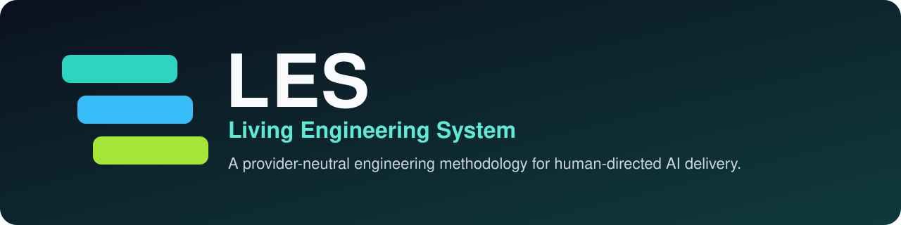
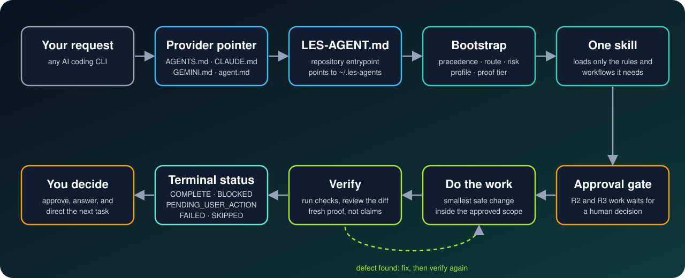

  

  

<h3 align="center">One engineering discipline for every AI coding CLI.</h3>

Classify the risk. Load only the context the task needs. Prove the result. 
Stop for a human wherever a human must decide.

~~~sh
npx -y @hakienit/les     # once per machine
cd my-project
les connect              # once per repository
~~~

Run `npx` outside a checkout of this repository, then open a new terminal so
`les` is on your `PATH`. Works on macOS, Linux, and Windows.

## Why LES

- **Every CLI, same rules.** Codex, Claude Code, Gemini CLI, and Antigravity read one bootstrap.
- **Evidence, not claims.** Every task ends in `COMPLETE`, `BLOCKED`, `PENDING_USER_ACTION`, `FAILED`, or `SKIPPED`, backed by the checks that ran.
- **Humans keep authority.** Risk levels `R0` to `R3` decide what needs approval. Push, history rewrite, and destructive cleanup are `R3`.
- **A team, priced by risk.** Small work stays with one agent. Larger work goes to departments with their own skills and model tier, and a writer never reviews its own change.
- **No footprint.** A repository gets `LES-AGENT.md` plus one pointer file per CLI. The LES source stays in `~/.les-agents`.

  

## Commands

| Command | What it does |
| --- | --- |
| `les update` | Fetch `@hakienit/les@latest` from npm and install it into `~/.les-agents`. |
| `les` | Install `~/.les-agents` from the running package. |
| `les init` | Create `LES-AGENT.md` only. |
| `les connect` | Set up the repository: create `LES-AGENT.md` and a pointer file for every CLI (Codex, Claude Code, Gemini CLI, Antigravity), and turn the guard and the team on. Rerun it any time; it is idempotent. |
| `les guard on`, `les guard off` | Turn the Claude Code guard on or off. `connect` already turns it on. |
| `les guard on codex`, `les guard off codex` | Same for Codex shell commands in `.codex/hooks.json`. |
| `les guard on gemini`, `les guard off gemini` | Same for Gemini CLI in `.gemini/settings.json`. |
| `les team on`, `les team off` | Add or remove the Claude Code subagents. `connect` already adds them. |
| `les lint FILE...` | Flag placeholders and unmeasurable acceptance criteria in a spec. |
| `les doctor`, `les status` | Check the install, the repository pointers, the guard, and for updates. |
| `les version` | Print the LES version. |

`les connect` also turns on:

- **Guard.** Hooks that block secret reads, deletes outside the project, and force pushes to protected branches. Claude Code also gets a gate on edits until the bootstrap is read; the session-start hook injects the bootstrap (under the 10,000-character hook cap) so nothing needs reading. A Stop hook sends back, once, a reply that used tools but lacks the LES status footer. Codex (`.codex/hooks.json`, trust the hooks with `/hooks`) and Gemini CLI (`.gemini/settings.json`) get the risky-call blocks without the read gate. The Claude Code guard fails closed (2.1.295+): if its script is missing or crashes, tool calls are blocked until you run `les guard off` in a normal terminal. A guardrail, not a sandbox.
- **Team.** One Claude Code subagent per LES department (Product, Architecture, Engineering, Frontend, QA, Security, Review, DevOps, Scout) in `.claude/agents`, each on a model sized to its job. The Lead dispatches only when the work needs it.

Add `--dry-run` to any repository command to preview it. LES never overwrites a
pointer file you own (`les connect` skips it and prints the pointer to add by hand), and it never writes to `~/.codex`, `~/.claude`, `~/.gemini`,
or other provider directories.

## Update

~~~sh
les update
~~~

Every repository points at the user store, so one update covers all of them.
`les doctor` reports new versions. LES never updates itself.

## Contributing

~~~sh
npm test && npm run verify-inventory && npm run verify-release
~~~

Release history is in `CHANGELOG.md`. MIT license, see `LICENSE`.
